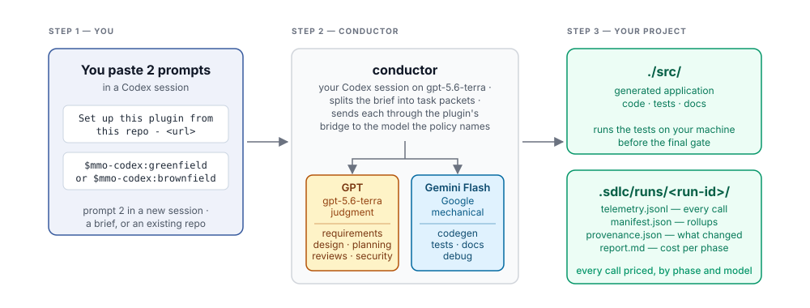
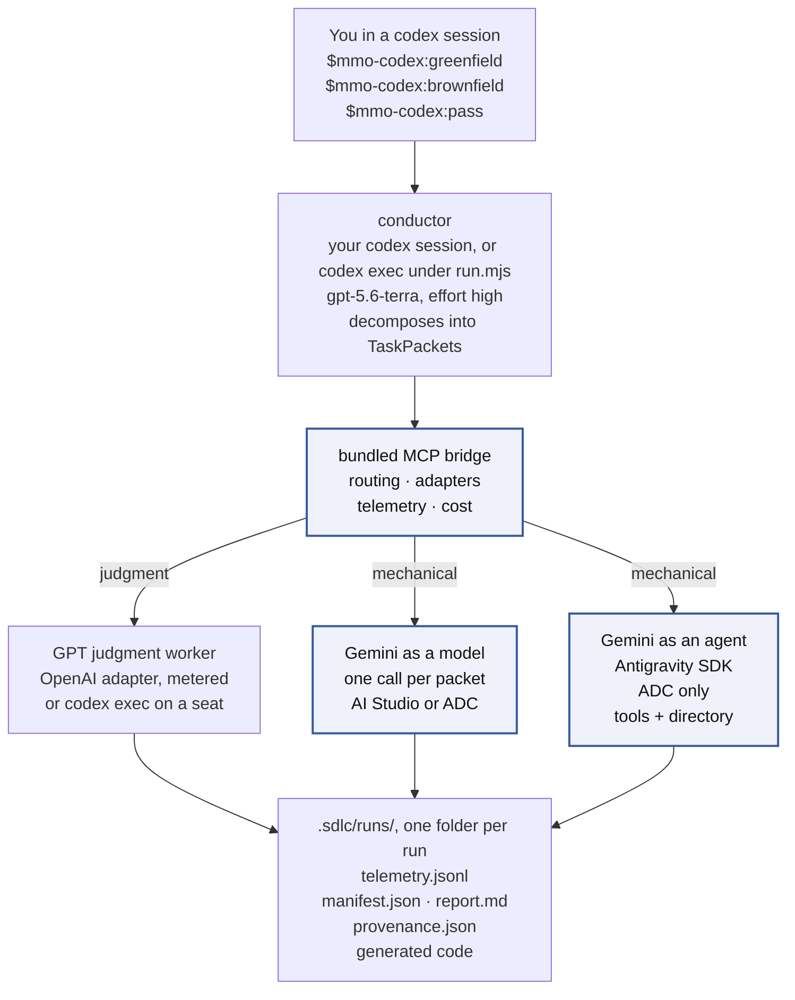
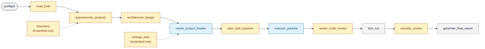

# AI-SDLC Orchestrator — Codex Harness

[](LICENSE)
[](https://github.com/tl-ai-labs/ai-sdlc-orchestrator-codex-harness/actions/workflows/test.yml)
[](plugin/.codex-plugin/plugin.json)



## What this is

A plugin for Codex. You give it a written description of an app you want, or of a change you want in a project you already have. It runs the whole software process inside Codex: requirements, design, code, tests, a senior code review and a security review. At set checkpoints it stops, shows you what it produced, and waits for you to approve it, ask for changes, or stop the run. At the end it reports what each step cost and which model did it.

Planning and review go to GPT, OpenAI's model. The routine writing of code, tests and docs goes to Gemini Flash, Google's lower-priced model. Every file a run writes, the cost report included, stays in your project folder.

This is the Codex version of the [Claude Code harness](https://github.com/tl-ai-labs/ai-sdlc-orchestrator-claude-code-harness): the same process, job types and briefs, run by Codex.

## Words to know

| Word | Meaning |
|---|---|
| Terminal | A window where you type commands to your computer. On a Mac it is the Terminal app, in Applications, then Utilities. On Windows, use the Ubuntu app that WSL2 installs. |
| Codex | OpenAI's coding agent. This plugin uses the version that runs in the terminal, the Codex CLI. It reads and changes the files in the folder you start it in, and runs commands there. |
| Session | One conversation with Codex. It starts when you type `codex` and ends when you type `/quit`. |
| Plugin | An add-on for Codex. This one adds the `$mmo-codex:` commands. |
| `$` command | A plugin command you type in the Codex chat, for example `$mmo-codex:setup`. Codex calls these skills. Typing `$` alone shows the list. |
| Sandbox | Codex's limit on what the commands it runs may do, such as reaching the internet. You turn it off for plugin runs in step 9. |
| Project folder | The folder that holds your app. You start Codex inside it. |
| Brief | A short written description of the app you want, under a fixed set of headings. The plugin can write one with you. |
| Model | The AI that does a piece of the work. Here: GPT (OpenAI) and Gemini Flash (Google). |
| Policy | The plugin's setting for which model does which step, and so who bills you for it. |
| Gate | A checkpoint where the run stops, shows you a file it wrote, and waits for your answer. |
| git | A tool that keeps a project's history. Work on an existing project needs it, so every change can be undone. |
| API key | A long secret code that lets a program use your OpenAI or Google account. Usage is billed to that account, separately from any ChatGPT plan. |
| Greenfield, brownfield | A new app built in an empty folder, and a change to a project that already exists. |

## Prerequisites — what you need

| If you want to | You need |
|---|---|
| Use the plugin at all | A Mac, a Linux computer, or Windows with WSL2. Node.js 20 or newer, git 2.30 or newer, and the Codex CLI 0.151.0 or newer, signed in. |
| Pay for the GPT work with an API key | An OpenAI API key. This is the default, and its cost figures are the ones OpenAI and Google report. |
| Pay for the GPT work with your ChatGPT plan | Codex signed in with your ChatGPT account, and the `gpt-seat-plus-flash` policy. No OpenAI API key. |
| Send the routine work to Gemini Flash | A Gemini API key from Google AI Studio, or a Google Cloud login. Every policy the plugin ships needs one of the two. |

You do not have to pick a policy now. Setup asks.

### Check what you have

Open a terminal and run each of these. Each one prints a version number.

```
node --version
```

```
git --version
```

```
codex --version
```

| Program | You need | If it is missing or older |
|---|---|---|
| Node.js | `v20` or higher | Install the version marked LTS from [nodejs.org](https://nodejs.org). |
| git | `2.30` or higher | On a Mac, run `xcode-select --install`. On Ubuntu and WSL, run `sudo apt install git`. |
| Codex CLI | `0.151.0` or higher | Once Node.js is installed, run `npm install -g @openai/codex` (npm comes with Node.js). To upgrade, run `npm install -g @openai/codex@latest`. If `codex --version` then says `command not found`, see [If something goes wrong](#if-something-goes-wrong). |

Then sign Codex in with your ChatGPT account. This command opens your browser:

```
codex login
```

Check that it worked:

```
codex login status
```

It prints `Logged in using ChatGPT`. If you have no ChatGPT account, skip these two commands: the end of [Give the plugin your keys](#give-the-plugin-your-keys) signs Codex in with an OpenAI API key instead.

### Give the plugin your keys

The plugin reads your keys from the terminal you start Codex in, as environment variables: named settings that every program started from that terminal can read. To have them set in every new terminal window, you put them in your terminal's startup file, `~/.zshrc` on a Mac and `~/.bashrc` on Linux and WSL.

1. Get the keys you need.
   - Gemini: create one at [aistudio.google.com/app/apikey](https://aistudio.google.com/app/apikey). A new key runs on Google's free tier, which limits how many calls you can make. To lift the limits, turn on billing for it in AI Studio.
   - OpenAI, if you pay with an API key: create one at [platform.openai.com/api-keys](https://platform.openai.com/api-keys). It is paid for separately from ChatGPT, so add credit on that site's Billing page before you use it.
2. Open the startup file. On a Mac:

   ```
   touch ~/.zshrc && open -e ~/.zshrc
   ```

   On Linux and WSL:

   ```
   nano ~/.bashrc
   ```

3. Copy these lines from this page and paste them at the end of the file. Then replace `your-gemini-key` and `your-openai-key` with your own keys. Leave out the OpenAI line if you pay with your ChatGPT plan.

   ```
   export GEMINI_API_KEY=your-gemini-key
   export OPENAI_API_KEY=your-openai-key
   ```

4. Save and close the file. In nano, press Ctrl+O, then Enter, then Ctrl+X.
5. Open a new terminal window and check that the key is there:

   ```
   test -n "$GEMINI_API_KEY" && echo set
   ```

   It prints `set`. If it prints nothing, the file was not saved, or this window was opened before you saved it.

Keep keys out of the Codex chat, because the chat is sent to OpenAI. If setup later reports a missing key, add it to the file, start Codex again as in [Coming back later](#coming-back-later), and type `$mmo-codex:setup`.

With a Google Cloud account you can skip the Gemini key. Run `gcloud auth application-default login` once: it saves a login file that the plugin finds by itself. If your account has several Google Cloud projects, also add `export GOOGLE_CLOUD_PROJECT=your-project-id` to the startup file, with your project's id.

If you have no ChatGPT account, sign Codex in with your OpenAI API key instead. Put the key in the startup file first, then open a new terminal window and run:

```
printenv OPENAI_API_KEY | codex login --with-api-key
```

The default policy, `gpt-plus-flash`, works with either sign-in.

## Setup — the two-prompt flow

You type two things in Codex: a sentence that installs the plugin, and later, in a new session, a command that starts a run. Between the two, you restart Codex with the settings a run needs.

### Install the plugin (prompt 1)

1. Open a terminal.
2. Make an empty folder for your first project and go into it (`~` is your home folder):

   ```
   mkdir ~/ping-service
   ```

   ```
   cd ~/ping-service
   ```

   To work on a project you already have, go into its folder instead, for example `cd ~/my-app`.
3. Start Codex:

   ```
   codex
   ```

   If Codex asks whether you trust this folder, choose the option that starts with Yes.
4. Paste this sentence into Codex and press Enter:

   ```
   Set up this plugin from this repo - https://github.com/tl-ai-labs/ai-sdlc-orchestrator-codex-harness
   ```

5. Codex downloads the plugin from GitHub, installs it, builds the small helper program the plugin uses to reach the models, and checks your keys. Each time it asks whether it may run a command, choose Yes. The downloads need the internet, which Codex blocks until you say yes. The steps it follows are in [INSTALL.md](INSTALL.md).
6. Answer its questions. It asks which policy this project should use: `gpt-plus-flash` if you pay with an OpenAI API key, `gpt-seat-plus-flash` if you pay with your ChatGPT plan ([Choosing how you pay](#choosing-how-you-pay) has all four). If it asks which Gemini route to use, choose the Gemini API. The other route runs Gemini as an agent, and needs a Google Cloud login and Python 3.10 or newer. If it asks you for a key, do not paste the key into the chat. Reply `skip`, and add the key to your startup file before step 9.
7. Each check prints a line with a mark:

   | Mark | Meaning |
   |---|---|
   | `✓` | Fine. |
   | `!` | A warning. One saying the codex CLI could not be checked can appear in this first session, and step 11 checks it again. |
   | `✗` | A problem to fix first. The line under it says how. |

   If you pay with your ChatGPT plan, the first check can show a `✗` line about `OPENAI_API_KEY`, because no policy is set yet. You do not need a key: reply `use gpt-seat-plus-flash`, and the line goes away once that policy is set.

   When it is done, it prints `✓ Setup complete for this project.` and the policy it set, then tells you the command to start Codex for a run (step 9 below).

### Restart Codex for runs

8. Quit Codex:

   ```
   /quit
   ```

9. Start Codex again in the same folder, with this command. If you added a key after step 6, open a new terminal window first and go back to the folder, for example with `cd ~/ping-service`.

   ```
   codex -s danger-full-access -m gpt-5.6-terra -c model_reasoning_effort="high"
   ```

10. The first time, Codex asks about the plugin's hook. Choose **Trust all and continue**. The hook is the check that keeps a run on an existing project from changing files outside the list you approve. Until you trust it, those runs stop right after their first gate.
11. To confirm the project is ready, type:

    ```
    $mmo-codex:setup
    ```

    It runs the same checks again. This time it can also check your Codex version and sign-in, which the first session's sandbox may have hidden from it. It ends with `✓ Setup complete for this project.` and the current policy.

The command in step 9 has these parts:

| Part of the command | Why it is there |
|---|---|
| `-s danger-full-access` | Turns off Codex's sandbox for this session. The plugin starts its helper program and talks to it directly, and the sandbox blocks that. Without it, the first model call fails with `MCP error -32000: Connection closed`. |
| `-m gpt-5.6-terra -c model_reasoning_effort="high"` | Starts the session on the model and effort that the plugin's prices and cost checks are based on. A run refuses to start on any other. |

With the sandbox off, Codex can run commands anywhere on your computer. Use this command for plugin runs, and plain `codex` for other work.

> **Why a new session matters.** Codex loads a plugin's commands, and asks about its hook, only when a session starts. The session you installed from may not have the `$mmo-codex:` commands yet, and it has neither the sandbox setting nor the model a run needs.

### Start a run (prompt 2)

In the session from step 9, you start a run by typing its command: `$mmo-codex:greenfield` for a new app in an empty folder, or `$mmo-codex:brownfield` for a change to a project you already have. For your first run, follow [Try it](#try-it--one-worked-example) below from step 1.

### Coming back later

Each time you come back to a project, or after you change a key:

1. Open a new terminal window.
2. Go to your project folder, for example:

   ```
   cd ~/ping-service
   ```

3. Start Codex with the command from step 9:

   ```
   codex -s danger-full-access -m gpt-5.6-terra -c model_reasoning_effort="high"
   ```

After a key change, type `$mmo-codex:setup` to check that Codex sees the new key.

## Try it — one worked example

### A new app: the Ping Service

The plugin ships a small example brief, the Ping Service: a web service with one address, `/ping`, that answers with the time. It is the quickest way to watch a whole run.

1. In the session from step 9, in `~/ping-service`, type:

   ```
   $mmo-codex:greenfield
   ```

2. Answer its questions:

| It asks | You reply |
|---|---|
| Which brief to build from | `the quick-demo example` |
| Where the code and the run record go: `src/` and `.sdlc/runs/<run-id>/` | `keep both` |
| It shows which model does which step, and what each one charges | Read it |
| Whether to start | `yes` |

Nothing is spent before your `yes`. The run then prints its run id, for example `20261014-091500-greenfield-3f9a1c`. Wherever this page shows `<run-id>`, use that id.

3. The run works on its own between gates. At each gate it prints a block that starts with `⏸ HITL Gate` (human in the loop: a point where you decide) and the gate's number, names the file to read, and waits for your reply.

| Gate | When | You read | You reply |
|---|---|---|---|
| 1 | After the requirements | `requirements.md` | `approved`, `revise: <what to change>`, or `abort` |
| 2 | After the design | `design.md` | The same |
| 3 | After the security review | `security_review.md` | The same |
| 4 | At the end | `SUMMARY.md`: the cost, the file count and the test results | `accept`, or `reject: <what to change>` |

In place of `<what to change>`, write what you want in your own words, for example `revise: also return the server version`. `abort` stops the run.

The files are in the run's folder, `.sdlc/runs/<run-id>/`. Codex is busy in your first window, so open a second terminal window (Cmd+N in Terminal) to read them. On a Mac, this opens the file in TextEdit:

```
open -e ~/ping-service/.sdlc/runs/<run-id>/requirements.md
```

On Linux and WSL, use `less` in place of `open -e`, and press q to close it. Finder hides folders whose names start with a dot, such as `.sdlc`. Press Cmd+Shift+. in a Finder window to show them.

To stop a run between gates, press Esc in Codex. To carry on in the same session, type `continue`. To carry on later from a new session, type `$mmo-codex:pass --resume=<run-id>`, where `<run-id>` is the name of the run's folder under `.sdlc/runs/`.

4. After `accept`, the run writes its cost report, `report.md` in the run folder, and prints a `Cost report:` line with the command that shows it again.

One recorded run of this brief, on `gpt-plus-flash`, took 20 minutes 47 seconds and produced a working app: `/ping` answers with status 200 and any other address with 404. The plugin's model calls in that run cost $0.5287. It was a run started from a terminal (a headless run) in September 2026, on an earlier version of the plugin. Your run will differ. The cost grows with the size of the brief and with every `revise`.

The $0.5287 leaves out your Codex session's own share. The report adds that share on its own line, worked out from the session's token counts, so the report's total is larger than the cost of the model calls alone. On `gpt-seat-plus-flash`, the GPT part comes out of your ChatGPT plan's allowance, and Google bills the Gemini part to the account behind your Gemini key or Google Cloud login. [docs/tutorial-first-run.md](docs/tutorial-first-run.md#7-find-the-record-and-the-cost) explains each line of the report.

To try the app, open a second terminal window and leave Codex running in the first:

```
cd ~/ping-service/src
```

```
npm install
```

```
npm test
```

```
npm start
```

While the app runs, open a third window and run:

```
curl -i localhost:3000/ping
```

It prints `HTTP/1.1 200 OK` and a JSON body with `status` set to `ok`. Press Ctrl+C in the window where the app runs to stop it.

### A change to an existing project

The project must be a git repository. If it is not one yet, run these in a terminal, in the project's folder:

```
git init
```

```
git add -A
```

```
git commit -m "before first run"
```

If `git commit` says `Author identity unknown`, git needs a name and an email address to record with your history. Run these once, with your own name and address in place of the examples, then run the commit again:

```
git config --global user.name "Your Name"
```

```
git config --global user.email "you@example.com"
```

`git init` starts a history for the folder, `git add -A` picks up every file, and `git commit` saves them as a point you can return to. In a project that is already a repository, run the last two before each run. The run backs up any file with uncommitted changes before it first changes it, but a commit gives you a clean point to return to.

To practise first, the plugin ships a small project with a known bug. [docs/tutorial-first-run.md](docs/tutorial-first-run.md#8-a-brownfield-run) has the commands to copy it out.

1. Start Codex in the project's folder with the command from step 9, and run `$mmo-codex:setup` there once.
2. Start a job with its command and a one-line description of the job. For example, on the practice project:

   ```
   $mmo-codex:bugfix POST /login returns 500 when the password is missing
   ```

   `$mmo-codex:brownfield` does the same, and asks which kind of job first. All seven jobs are in [Commands](#commands).
3. The first run in a project starts with a short check, which includes one small paid call to each model. Then the plugin reads the project and stops at Gate 0, before it writes anything.
4. Gate 0 shows:
   - what it found in the project: the language and the test command
   - the policy and the job
   - the files it proposes to change, and the files it must not touch
   - a typical cost for this job on a project this size

   It also lists any settings files of other AI tools it found, and leaves them alone unless you add one to the files it may change. Reply `revise: <what to change>` to correct anything, then `approved`. If it asks whether to add `.sdlc/` to `.gitignore` (the list of files git leaves out), answer yes.
5. From then on the run may write only the files you approved. Gates 1 to 4 follow as above, without the ones the job does not need: a bug fix skips the design gate unless the fix changes the design.
6. After `accept`, the run prints `$mmo-codex:revert <run-id>`, which undoes every change it made.

If a job on an existing project stops before the end, the next job you start in that project offers to resume it or to drop it.

## Commands

Type `$` in Codex to see the list, or `/skills` to browse it.

### Start a run

| Command | What it does |
|---|---|
| [`$mmo-codex:greenfield`](plugin/skills/greenfield/SKILL.md) | Builds a new app from a brief, in an empty folder. It can write the brief with you. |
| [`$mmo-codex:brownfield`](plugin/skills/brownfield/SKILL.md) | Changes an existing project. It asks which of the seven jobs below to do. |
| [`$mmo-codex:pass`](plugin/skills/pass/SKILL.md) | Starts a run from options instead of questions, for scripts and repeat runs. [docs/running.md](docs/running.md) lists the options. |

### Jobs on an existing project

Each one starts `$mmo-codex:brownfield` with the job already chosen. A line describing the job after the command is optional. Gate 0 asks you to confirm the files either way.

| Command | What it does | Example |
|---|---|---|
| [`$mmo-codex:bugfix`](plugin/skills/bugfix/SKILL.md) | Reproduces a bug, fixes it, and adds a test that proves the fix | the /login endpoint returns 500 on a missing password |
| [`$mmo-codex:feature-extend`](plugin/skills/feature-extend/SKILL.md) | Adds to a feature that already exists | add a `?filter` option to the existing /users endpoint |
| [`$mmo-codex:feature-new`](plugin/skills/feature-new/SKILL.md) | Adds a new part to the app: endpoint, storage and tests | add a webhooks module with a retry loop |
| [`$mmo-codex:docs`](plugin/skills/docs/SKILL.md) | Writes or updates documentation: API docs, README, decision records, code comments | document the auth module |
| [`$mmo-codex:test`](plugin/skills/test/SKILL.md) | Adds tests toward a coverage target | unit tests for src/payments to reach 80% line coverage |
| [`$mmo-codex:refactor`](plugin/skills/refactor/SKILL.md) | Moves repeated code into one place and updates every use, checked by the full test suite | move the shared date logic into a util module |
| [`$mmo-codex:deps`](plugin/skills/deps/SKILL.md) | Upgrades a library and fixes the code the upgrade breaks | upgrade jest from 28 to 29 |

### Setup, policy and undo

| Command | What it does |
|---|---|
| [`$mmo-codex:setup`](plugin/skills/setup/SKILL.md) | Checks the install and your keys, rebuilds the helper program when needed, and sets this project's policy. Safe to run any time. |
| [`$mmo-codex:policy`](plugin/skills/policy/SKILL.md) | Shows this project's policy. `$mmo-codex:policy change` picks a different one. |
| [`$mmo-codex:revert`](plugin/skills/revert/SKILL.md) | Undoes the file changes of one run on an existing project: `$mmo-codex:revert <run-id>`. |

The seven job commands and `$mmo-codex:pass` start only when you type them. `$mmo-codex:greenfield` and `$mmo-codex:brownfield` can also start when you ask Codex for that work in plain words. A new app's run spends nothing before your `yes`. On an existing project's first run, the short check before Gate 0 makes one small paid call to each model. The `/skills` list also shows two playbooks that a run follows, `pipeline` and `brownfield-guide`; you do not type those.

## Choosing how you pay

A policy decides which model does each step, and so who bills you. The plugin comes with four. Every policy also needs Codex signed in, because your Codex session drives every run and uses that sign-in.

| Policy | What you need | Costs on the report |
|---|---|---|
| `gpt-plus-flash` (the default) | An OpenAI API key, and a Gemini key or a Google Cloud login | Metered by OpenAI and Google |
| `gpt-plus-flash-38` | The same as `gpt-plus-flash` | Metered. The reports name Gemini 3.8 Flash, the model Google now serves for 3.7 requests |
| `gpt-seat-plus-flash` | Codex signed in with your ChatGPT plan, and a Gemini key or a Google Cloud login. No OpenAI API key | GPT work modeled, Gemini work metered |
| `flash-agsdk-only` | A Google Cloud login (there is no key option) and Python 3.10 or newer (the Python that comes with macOS, 3.9, is too old) | Metered. Every step the plugin sends out goes to Gemini running as an agent. Use it to try that route |

To switch this project to another policy, type:

```
$mmo-codex:policy change
```

Metered figures (the report says vendor-metered) are the usage OpenAI and Google report for each call. Modeled figures are worked out from token counts at list prices, because a ChatGPT plan reports tokens but no money. Your Codex session's own share is modeled this way on every policy. A row the report marks `E` (estimated) is a call that came back without usage figures, so its tokens were counted from the text. Pick `gpt-plus-flash` when the cost figures matter, for example when you share them.

On `gpt-seat-plus-flash`, a run's GPT work comes out of the same ChatGPT plan allowance as your Codex session, so a long run can reach your plan's usage limit.

Every shipped policy stops a run once its recorded cost reaches $50: the plugin's model calls plus the session's modeled share.

## Undo and safety

To undo a run on an existing project, type `$mmo-codex:revert <run-id>`. It puts every file the run changed back the way it was, from git or from the run's own backups. If a file changed again after the run, it shows you the difference and asks before it touches that file. A new app lives in its own folder; to remove it, delete the folder.

On an existing project, the hook you trusted in step 10 refuses any write outside the files you approved at Gate 0, and records each decision in `.sdlc/local/guard-decisions.jsonl`. Some files are refused in every session: `.env` files, everything under `.git/` and `.agents/`, Codex's own settings (`.codex/config.toml`, `.codex/auth.json`) and `.mcp.json`.

The hook checks ordinary file writes. A write made some other way, for example by a script the model runs, can get past it. Commit your work in git before a run, so you can always get back to it. [docs/architecture.md](docs/architecture.md#what-the-contract-guarantees-and-what-it-does-not) lists what the hook covers and what it does not.

What leaves your computer is what the models need to do the work: the Codex session talks to OpenAI, and each model call the plugin makes sends its instructions, with the parts of your brief or code they need, to OpenAI or Google. The plugin uploads nothing else.

## What a run produces

Each run gets its own folder in your project, `.sdlc/runs/<run-id>/`. A new app's code goes in `src/`. Changes to an existing project are made in place.

| File in the run folder | What it holds |
|---|---|
| `requirements.md`, `design.md`, `security_review.md`, `SUMMARY.md` | What you read at the gates |
| `report.md` | The cost report: cost by step and by model, and the run total split into its metered and modeled parts |
| `telemetry.jsonl` | One line per model call: the step, the model, the tokens and the cost |
| `gates.jsonl` | Your answer at each gate |
| `driver-usage.json` | The Codex session's own tokens and modeled cost |
| `provenance.json` | Existing projects: every file the run changed, which `$mmo-codex:revert` reads |

Outside the run folders, `.sdlc/local/guard-decisions.jsonl` lists every write the hook allowed or refused. [docs/running.md](docs/running.md#what-lands-in-the-run-folder) describes every file, and [docs/understanding-output.md](docs/understanding-output.md) explains the report line by line.

## If something goes wrong

| What you see | Why | What to do |
|---|---|---|
| `npm install -g @openai/codex` fails with `EACCES` or `permission denied` | Node.js was installed for every user of the computer, so npm may not add programs to its folder | On a Mac, install Node.js with [Homebrew](https://brew.sh) instead (`brew install node`), open a new terminal window, and run the Codex install again. On Linux and WSL, run the install with `sudo` in front. |
| `codex: command not found` after you install Codex | The terminal window was open before the install, or npm's folder for installed programs is not on your terminal's search path | Open a new terminal window and run `codex --version` again. If it still fails, follow the `codex: command not found` row of [docs/troubleshooting.md](docs/troubleshooting.md#install-and-prerequisites). |
| A run on an existing project stops after Gate 0 with `The write guard did not run in this session` | The plugin's hook is not trusted yet, or a plugin update changed it | Quit Codex, start it with the command from step 9, and choose **Trust all and continue**. Or type `/hooks` and trust the mmo-codex hook. Then start the job again. |
| `no run started: this session must run gpt-5.6-terra at effort high` | Codex was started without the model settings | Type `/model`, choose `gpt-5.6-terra` and effort `high`, send one message, then start the command again. Or quit and use the command from step 9. |
| `MCP error -32000: Connection closed` | Codex was started without `-s danger-full-access`, so its sandbox blocks the plugin's helper program | Quit and start Codex with the command from step 9. |
| `No Gemini credentials found` | No Gemini key reached Codex | Add `GEMINI_API_KEY` to your startup file as in [Give the plugin your keys](#give-the-plugin-your-keys), start Codex again as in [Coming back later](#coming-back-later), and type `$mmo-codex:setup`. Or run `gcloud auth application-default login`. |
| `OPENAI_API_KEY is not set` | This project's policy pays for GPT with an API key, and none is set | Add the key the same way. Or move to your ChatGPT plan: `$mmo-codex:policy change`, then `gpt-seat-plus-flash`. |
| `The bundled MCP server is not built`, or runs fail after a plugin update | An update replaces the plugin's files and removes the built helper program | Type `$mmo-codex:setup`, which builds it again. |
| A run stops and the message mentions a usage limit | Your Codex session runs on your ChatGPT plan, and on `gpt-seat-plus-flash` the run's GPT work does too | Wait for the limit to reset, then type `continue` in the same session, or `$mmo-codex:pass --resume=<run-id>` in a new one. A policy with an API key takes the judgment work off your plan. Signing Codex in with an API key (`printenv OPENAI_API_KEY \| codex login --with-api-key`) takes the session off it too. |
| The `$mmo-codex:` commands do not appear when you type `$` | The plugin was installed after this session started, or it is not installed | Quit and start Codex again with the command from step 9. If the commands are still missing, run `codex plugin list` in a terminal. It lists `mmo-codex@tilicho-ai-labs` as installed and enabled; if it does not, paste the setup sentence again. |

[docs/troubleshooting.md](docs/troubleshooting.md) lists every message the plugin can show, with its cause and its fix.

## Verify or repair the install

Run the setup check whenever something looks wrong, after a plugin update, or after you change a key. It rebuilds the helper program when needed, checks your keys, and names anything missing with its fix. Inside a Codex session:

```
$mmo-codex:setup
```

From a terminal, outside Codex:

```
node "$(ls -d ~/.codex/plugins/cache/tilicho-ai-labs/mmo-codex/*/codex/verify-setup.mjs | tail -1)" --fix --project-root "$(pwd)"
```

Running either one again changes nothing that is already right.

To update the plugin, run these two commands in a terminal:

```
codex plugin marketplace upgrade
```

```
codex plugin add mmo-codex@tilicho-ai-labs
```

Then start Codex with the command from step 9, choose **Trust all and continue** if it asks about the hook, and type `$mmo-codex:setup`.

## How it works inside

### What calls what



The conductor is the Codex session itself, on `gpt-5.6-terra` at effort `high`. It splits the work into task packets and hands each one to the bundled bridge, which sends it to the model the policy names and records the call. The highlighted path is where the cost drops: mechanical work leaves the judgment tier for the cheaper one. Gemini can be reached as a model, one call per packet, or as an agent with tools and a working folder. Setup picks one, and both bill the same rates per token.

Unlike in the Claude harness, the model never calls the bridge as a tool. A model inside Codex has no per-tool binding for an MCP server, so the conductor runs `plugin/codex/dispatch.mjs`, a shell command that opens the connection itself. That is why a run needs `-s danger-full-access`. The measurements are in [docs/verification/p1-codex-runtime.md](docs/verification/p1-codex-runtime.md), and the design that follows from them in [docs/architecture.md](docs/architecture.md).

### The steps of a run



Amber steps run on GPT (judgment), blue ones on Gemini Flash (mechanical), and grey ones on your machine with no model call. A greenfield run walks these states in order; `cache_project_header` runs only on a policy that mixes GPT and Gemini. A brownfield run adds `discovery` and `change_plan` around the same core. The gates come after requirements (Gate 1), after the design (Gate 2), after the security review (Gate 3) and before final acceptance (Gate 4). Brownfield adds Gate 0, the scope confirmation, before all of them. The full state machine is in [plugin/skills/pipeline/SKILL.md](plugin/skills/pipeline/SKILL.md).

### Which model does each step

The default `gpt-plus-flash` policy routes greenfield and brownfield runs the same way:

| Phase | Tier | Model in the default policy |
|---|---|---|
| `requirements_analysis` · `architecture_design` · `plan_task_packets` | judgment | `gpt-5.6-terra`, effort `high` |
| `senior_code_review` · `security_review` | judgment | `gpt-5.6-terra`, effort `high` |
| `discovery` · `change_plan` (brownfield only) | judgment | `gpt-5.6-terra`, effort `high` |
| `codegen` · `tests` · `docs` (the `execute_packets` step) | mechanical | Gemini 3.7 Flash, for `codegen` only on the task types the policy lists; any other task goes to GPT |
| `debug` | mechanical | Gemini 3.7 Flash |
| `codegen` · `tests` · `docs` · `debug` with `retry_count` ≥ 2 | judgment | `gpt-5.6-terra` (escalation) |
| `test_run` | local | Bash on your machine, no model call |

Source: [plugin/config/policies/gpt-plus-flash.yaml](plugin/config/policies/gpt-plus-flash.yaml). To change the routing, edit the YAML, or write a new policy with the "Author a new policy" choice of `$mmo-codex:policy change`, which opens a browser console.

Every shipped policy has two limits switched on:

| Limit | What it does |
|---|---|
| Escalation | A mechanical-tier packet that fails its checks twice goes to GPT on the third attempt, so a case Flash cannot solve does not retry forever. |
| Hard cost cap | `$50` per run (`hard_cost_cap_usd` in the policy). The cap counts the dispatched cost in the run's `telemetry.jsonl` plus the conductor's own modeled cost from the same run folder. Once that total reaches the cap, the bridge refuses every further dispatch and `run.mjs` stops resuming. The call that crosses the cap still completes, and the conductor's current turn still runs, so a run can overshoot by part of one turn. A conductor on a model other than the policy's pin is not priced and adds $0. Raise the cap, or delete the key for no cap, in a policy of your own. |

### Which model does each job

| Job | When to use it | Who does most of the work |
|---|---|---|
| `docs` | API docs, README, ADRs, docstrings | Gemini Flash |
| `bugfix` | A specific defect: reproduce, diagnose, fix, regression test | Gemini Flash, escalating to GPT after 2 failed retries |
| `feature-extend` | A capability added to an existing endpoint or module | GPT for the change plan, Gemini for the edits |
| `feature-new` | A new subsystem: endpoint, storage, tests | GPT for the design, Gemini for the code |
| `refactor` | Shared logic extracted; the full test suite checks the result | GPT for the refactor plan, Gemini for `refactor_extract` and the patches |
| `test` | Tests backfilled to a coverage target | Gemini Flash |
| `deps` | A dependency upgraded, with the breaking changes patched | GPT for the upgrade plan, Gemini for the patches to nearby code |

The intent-by-phase matrix is in [plugin/skills/pipeline/SKILL.md](plugin/skills/pipeline/SKILL.md).

### Two paths to GPT

The conductor and the judgment work both run on GPT, through different paths. The conductor runs on your Codex sign-in. Judgment work goes through the bridge, one telemetry line per call: as metered API calls on `OPENAI_API_KEY`, or under `gpt-seat-plus-flash` as a `codex exec` subprocess on your ChatGPT plan, at the same model and effort. That way each judgment call is recorded against its phase, and the conductor's own cost stays on a separate line of the report.

### The write contract on existing projects

Gate 0 freezes a write contract: the files the run may change and the ones it must not touch. One hook script judges every patch and shell command the model runs against it, and the model cannot edit the contract while the run is live. A headless `run.mjs` run registers the hook itself. In a Codex session the hook runs once you trust it, and the run stops right after Gate 0 when no hook decision was recorded. [docs/architecture.md](docs/architecture.md#what-the-contract-guarantees-and-what-it-does-not) says where the guard runs, what it enforces and what it does not.

### Checking the cost figures

In a Codex session, the conductor's cost is read from Codex's session file at the end of the run. A headless run checks that reading: `plugin/codex/run.mjs` drives the same run from a terminal with `codex exec --json`, and at the end compares Codex's own per-turn token counts with the session-file reading, token for token. [docs/headless-runs.md](docs/headless-runs.md) is the procedure, including the check against the OpenAI usage dashboard.

### The worked example's price

The Ping Service figure above was priced at Gemini rates of $1.50 / $0.15 / $9.00 per 1M tokens (input / cached input / output), about twice Gemini 3.7 Flash's introductory card. The dated price list, [plugin/mcp/model-dispatch/src/prices.ts](plugin/mcp/model-dispatch/src/prices.ts), bills Gemini 3.7 Flash at $0.75 / $0.075 / $3.75 through 2026-12-31 and $1.50 / $0.15 / $7.50 from 2027-01-01, so the same run re-priced costs less on either card. The GPT share is unaffected. The first report of a run in a Codex session marks the session's line `PROVISIONAL`, because it is read before the session's last turn ends; [docs/tutorial-first-run.md](docs/tutorial-first-run.md#7-find-the-record-and-the-cost) shows how to read it again afterwards.

## Documentation

| Doc | What it covers |
|---|---|
| [docs/tutorial-first-run.md](docs/tutorial-first-run.md) | A new app and a change to an existing project in a Codex session, step by step, gate by gate |
| [docs/running.md](docs/running.md) | The policies, the gates, every option of a headless run, and every file in the run folder |
| [docs/brief-template.md](docs/brief-template.md) | The headings a brief needs, to write your own |
| [docs/understanding-output.md](docs/understanding-output.md) | The cost report line by line, and the raw files a run leaves behind |
| [docs/headless-runs.md](docs/headless-runs.md) | Double-checking the cost figures: a run from a terminal, the token cross-check, and the OpenAI usage dashboard |
| [docs/troubleshooting.md](docs/troubleshooting.md) | Every message the plugin can show, with its cause and its fix |
| [docs/architecture.md](docs/architecture.md) | What calls what, the adapters, routing, the write contract, telemetry, the install routes |
| [docs/methodology.md](docs/methodology.md) | How tokens and costs are recorded, and why modeled figures stay out of the vendor-metered total |
| [SETUP.md](SETUP.md) | The manual install, working from a clone (`node tools/setup.mjs`), credentials in detail, uninstalling |
| [INSTALL.md](INSTALL.md) | The steps Codex follows when you paste the setup sentence |
| [docs/verification/p1-codex-runtime.md](docs/verification/p1-codex-runtime.md) | The Codex behaviour this plugin is built on, as measured: the pinned model and effort, and the findings that shaped the design, including why runs need `-s danger-full-access` |
| [CONTRIBUTING.md](CONTRIBUTING.md) | Changing the plugin itself: branches, style rules, testing a branch in Codex, pull requests |
| [examples/quick-demo/](examples/quick-demo/) | The smallest brief: one endpoint, about twenty minutes |
| [examples/workforce-ops/](examples/workforce-ops/) | The reference brief: five modules, an hour or more |
| [examples/travel-ops/](examples/travel-ops/) | A second large brief: booking, cancellation and refund handling |

## License

MIT. See [LICENSE](LICENSE).

---

<p align="center">
  <a href="https://tilicho.in">
    
  </a>
  <br />
  Built and maintained by <a href="https://tilicho.in">Tilicho</a>.
</p>
