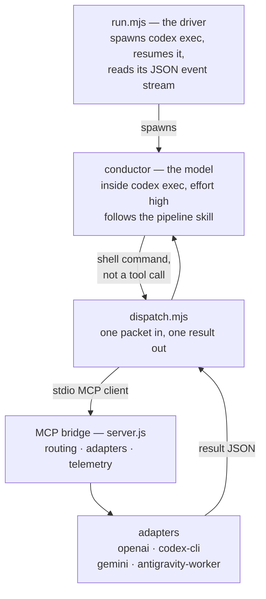

# Architecture

> **For:** understanding how a request flows through the harness, and what each file is for. **Also see:** [running.md](running.md) · [methodology.md](methodology.md) · [verification/p1-codex-runtime.md](verification/p1-codex-runtime.md)

The shape of this harness follows from one measured finding: a model running inside `codex exec` cannot call an MCP server's tools. Everything below is downstream of that.

## 1. Who calls what

In the Claude harness, the orchestrator subagent calls the bundled MCP server as a tool. That is not available here. Check 4 in [verification/p1-codex-runtime.md](verification/p1-codex-runtime.md) found that a model inside a plain `codex exec` session has no per-tool binding for this server — the MCP primitives codex does expose are Resources, and this server implements Tools.

So the driver calls the bridge, and the model never does:

In a codex session there is no `run.mjs`: the session is the conductor, and the same shell command reaches the bridge. The conductor dispatches by running a shell command. `dispatch.mjs` is an ordinary MCP client that spawns the bridge, calls one tool, and exits. That is why dispatch needs a session permitted to open pipes to a child process — see the sandbox entry in [troubleshooting.md](troubleshooting.md#dispatch-and-the-bridge).

## 2. The two entry points

A run starts one of two ways, and both render the same playbooks into `<run folder>/skills/` and end through `plugin/codex/run-finalize.mjs`.

| Route | Starts the run | Ends the run | Records |
|---|---|---|---|
| In a codex session, from a `$mmo-codex:*` skill | `plugin/codex/start-run.mjs`: checks the session's model and effort, resolves the policy, creates the run folder, renders the playbooks, writes `run.json` | `plugin/codex/end-run.mjs --outcome=<outcome>`: closes `run.json`, logs `run.end`, then the run-end steps | `run.json`, `driver-session.jsonl` (a marker per start, dispatch and collection), `orchestrator.log` |
| Headless, `plugin/codex/run.mjs` | Spawns `codex exec` with a pinned model, reasoning effort, sandbox and approval policy, and resumes the same session until the run ends | Its own run end, with the outcome its records show | `driver-events.jsonl`, `driver-stderr.log`, `driver-cost-modeled.jsonl`, `driver-manifest.json` |

The run-end steps are the same on both routes: the conductor's cost read from its codex session file into `driver-usage.json` (cross-checked against the exec stream on a headless run), a brownfield run's write contract ended with the run's outcome, `manifest.json`, and `report.md`.

The rest of this section is the headless driver.

- **Completion signal.** The latest Gate 4 line in `gates.jsonl` accepts the run, and a `SUMMARY.md` that `plugin/scripts/write-manifest.mjs` wrote after it: Phase 9 runs the script, and Gate 4's acceptance runs it again with `--status=accepted`. The model writes neither `manifest.json` nor `SUMMARY.md`, and `manifest.json` records the summary's hash, so a hand-written summary never reads as completion.
- **Why resuming is normal.** One turn ends when the session hits its context ceiling — exit 0, no error. `--max-turns` (default 12) caps how many turns one run may use.
- **The fairness pin.** The model and effort are read back out of the built `codex exec` argv and asserted against the policy's `driver:` block before spending. A mismatch aborts rather than quietly running a different model than the one the cost figures will be attributed to. See `plugin/codex/telemetry/fairnessPin.mjs`.
- **One policy resolver.** `run.mjs` and `start-run.mjs` resolve their policy through the bridge's `dist/policy.js`. `run.mjs` hands codex the resolved file in `MMO_POLICY_PATH`, which `dispatch.mjs` forwards as `policy_path`. The policy that prices and caps the run is the one every dispatch routes by.
- **The session model check.** In a codex session, `start-run.mjs` reads the session's last `turn_context` from its rollout file (found by `CODEX_THREAD_ID`) and starts no run unless the model and effort match the policy's `driver:` block. See `plugin/codex/session-model.mjs`.

## 3. The bridge — `plugin/mcp/model-dispatch/`

A stdio MCP server. Five tools, unchanged from the Claude harness:

| Tool | Purpose |
|---|---|
| `execute_with_model` | Route one TaskPacket to the model the policy names, and return the result. |
| `preflight_dispatch` | Prove every model this run would dispatch to is constructible, before spending. No API call. |
| `load_policy` | Return the parsed policy the run is operating under. |
| `simulate_policy` | Given the telemetry from a real run, recompute what it would have cost under a different policy. No model calls. |
| `log_telemetry` | Append one event to `telemetry.jsonl`. |

`driverClient.ts` is the client side — it spawns the server, sets a 900-second per-call timeout, and diagnoses a failed connection. The default MCP SDK timeout is 60 seconds, which is far below what a real dispatch at effort `high` takes; that mismatch killed a reference run once and the comment in that file records it.

## 4. Adapters — `plugin/mcp/model-dispatch/src/adapters/`

One per way of reaching a model. A policy names an adapter per model entry.

| Adapter | Reaches | Credential |
|---|---|---|
| `openai` | GPT through the OpenAI API | `OPENAI_API_KEY`, metered |
| `codex-cli` | GPT through a local `codex exec` subprocess | the CLI's own login — a ChatGPT seat |
| `mcp:model-dispatch` → `GeminiFlashAdapter` | Gemini as a model, one completion per packet | `GEMINI_API_KEY` or Google Cloud ADC |
| `antigravity-worker` | Gemini as an agent session with tools and a working directory | Vertex ADC only — no API-key door |

`BuiltinAnthropicAdapter` and `ClaudeCliAdapter` are carried from the source, compiled and tested, and never reached: no shipped policy names them, and `run-policy.mjs` refuses a policy that does.

The `openai` and `codex-cli` adapters reach the same model. They are separate because they bill differently, and keeping them distinct is what makes per-phase cost attribution honest — one produces metered figures, the other modeled ones.

Both hold a reply to the packet's `outputSchema` when OpenAI strict mode accepts that schema (`src/adapters/strictSchema.ts`): `openai` sends it as the Responses API's `text.format` with `strict: true`, and `codex-cli` passes it to `codex exec --output-schema`. A schema strict mode would refuse, or one past its documented size limits (10 levels of nesting, 5000 properties, 1000 enum values), goes unenforced through `openai`, and inside a one-field envelope through `codex-cli`. A strict-mode refusal from the model is a failed dispatch whose error carries the model's reason. The Phase 4 plan schemas in `plugin/config/schemas/` pass strict mode. `plugin/scripts/plan-packets.mjs` builds the planner's packet around them and checks the plan it returns (phases, task types, targets against the frozen allowlist, off-limits inputs, each child's schema) before it writes `packets.json`.

## 5. Routing — `plugin/config/policies/*.yaml`

Routing is data, not code. Each policy declares `models:` (id, adapter, model name, auth, and a `pricing:` block that records the dated price list's card in `src/prices.ts` and is billed only under `pricing_override: true`) and `rules:` (a `when:` clause matched against phase and retry count, and the model to `use:`). First match wins; a bare `when:` is the fallback.

Two guardrails ship on: a mechanical packet that fails validation twice escalates to the judgment tier on the third attempt, and `hard_cost_cap_usd` stops the run once the dispatched cost in `telemetry.jsonl` plus the conductor's modeled cost reaches it. The bridge refuses every dispatch after that point (`src/costCap.ts`), and `run.mjs` stops resuming the session and records `cost_cap_stop` in `driver-manifest.json`. `src/sessionUsage.ts` reads the conductor's cost from the same run folder, from one source: `driver-usage.json` when nothing was recorded after it was collected, else the complete rows of `driver-cost-modeled.jsonl` plus the session file's turns of any invocation no row reports yet (the one running), else the conductor's codex session file. A headless run names the conductor's thread in `driver-events.jsonl`; an interactive run names it in `driver-session.jsonl`, where `dispatch.mjs` appends a marker on every call. The refusal message gives both parts and says which is modeled.

The four shipped policies are described in [running.md](running.md#policies).

## 6. The two Gemini doors

Both reach the same model at the same rates. Which one an install uses is written to `.sdlc/local/mmo-select.json` by `verify-setup.mjs --enable-agent`, and the driver folds it into the environment it passes when it spawns the bridge.

This lives in install state rather than in the policy on purpose: the policy file stays a faithful record of how a run was priced and routed, rather than something edited between runs. The `model_id` on each telemetry event is what says which door ran.

## 7. The write contract — `plugin/codex/hooks/write-contract-check.mjs`

A PreToolUse hook on `apply_patch` and `Bash`. The script only reads the call and replies; the decision is in `plugin/scripts/lib/write-guard.mjs`. Codex blocks a call on a JSON `deny` reply alone, not on an exit code. An allow is an empty reply, because Codex reports a bare `permissionDecision: "allow"` as a failed hook run. Any failure inside the hook allows the call. A Bash call's `tool_input.command` is read as a string or as an argv array; an `apply_patch` patch is read from `tool_input.command` or `tool_input.input`.

**Lifecycle.** `plugin/scripts/write-contract.mjs` owns the contract; the model never writes it.

| Step | Command | Effect |
|---|---|---|
| Gate 0 approved | `--freeze --run-id=<id> --allowlist='<json>' [--off-limits='<json>'] [--strict-write=off] [--intent=<id>]` | Writes `.sdlc/local/write-contract.json` (project defaults from `.sdlc/project.json` merged in), `runs/<id>/write-contract.frozen.json` and `runs/<id>/write-contract.lock.json` with the SHA-256, then opens `runs/<id>/provenance.json`. Refused outside a git project's root, for a second freeze of one run, and while another run is live. |
| Right after, and after every resume | `--assert-guard-live` | Passes when the decision log holds a row for the run stamped after the freeze, or after the latest resume in the lock's `reopened_at`. Otherwise ends the run and exits 2, saying the guard did not run. |
| Gate 4 answered | `--close --run-id=<id>` | Needs an accepted Gate 4 or an abort in `runs/<id>/gates.jsonl`. Writes the lock's end record, closes `provenance.json`, then switches the contract off. |
| The person ends a run | `--abandon --run-id=<id> [--reason=<text>]` | The same end, as `aborted`. Frees a project held by a killed session or a changed contract. |
| Any other run end | `endRun()` | `run-finalize.mjs` calls it with the run's outcome, from `run.mjs` and from `end-run.mjs`; a run-end step that fails before it is a note. A `run.mjs` that stops on an error of its own ends it as `failed` and prints the `--resume` command. A run that never froze, or whose close-out ended it, is left as it is. |
| `--resume` | `reopenRun()` | `run.mjs --resume` and `start-run.mjs --resume` call it before anything runs. A stopped run reopens with its frozen bytes and its provenance record; one that ended `completed` or `aborted` is refused (exit 2). Every resume of a frozen run, a still-live one included, is stamped in `reopened_at`, and `start-run.mjs` prints the guard check for the session to run before its first write. A fresh brownfield `run.mjs` run is refused before spending while another run holds the project. |

**Rule order** for each path a write names, judged as written and again with every link resolved:

| # | Rule | Answer |
|---|---|---|
| 1 | The contract's bytes no longer match a live lock, two locks are live, or a frozen contract's lock is gone | Refuse every write in the project |
| 2 | A binding contract, and the path is the contract, or the run's lock, frozen copy, `skills/`, `provenance.json` or `backups/`; a shell word that may expand to one of them (glob, braces, quotes, a variable) | Refuse (also for `rm`, `unlink`, `git rm` and `mv` sources, under a live lock) |
| 3 | `.env`, `.env.*`, `.mcp.json`, `.codex/config.toml`, `.codex/auth.json`, `.git/**`, `.agents/**` at any depth, any case; `.git` and `.agents` themselves too | Refuse, except creating a missing `.env`, `.env.example` or `.env.test` when no contract binds, by an `apply_patch` Add File or a shell write to an absolute path with no variable, glob or command substitution in it (quoted or not). A shell removal (`rm`, `unlink`, `git rm`, an `mv` source) of such a path or of the `.codex` folder is refused too, judged by the name it removes, not where a link of that name points; a glob by each such name it may match (`rm -rf .git/*`, `rm -f .env.prod*`) |
| 4 | No binding contract | Allow |
| 5 | The path is inside `.sdlc/runs/<run_id>/` | Allow |
| 6 | The contract's `off_limits`, any case | Refuse (warn and allow under `strict: false`) |
| 7 | The contract's `allowlist` | Allow |
| 8 | Anything else | Refuse (warn and allow under `strict: false`) |

An allowlist or off-limits pattern takes `**` for any characters, and a `**` folder for zero or more folders, so `src/**/*.ts` takes `src/a.ts` and `**/*.md` takes `README.md`; `*` and `?` stay within one name, and a leading `./` is the project root.

The scan (`plugin/scripts/lib/shell-scan.mjs`) splits a command as sh, bash and zsh do: a quoted or backslash-escaped word is one word, spaces kept, and an argument list ends at an unquoted newline or comment. A command is a word at a command position (the start, or after `;`, `&&`, `||`, `|`, `(` or a newline), past `NAME=value` assignments and wrappers such as `sudo`, `env`, `time`, `timeout`, `xargs`, `setsid`, `flock` (its `-c` string is read as shell), `arch`, `ionice` and `busybox`; a word starting with `-` is never one. The GNU tools Homebrew installs with a `g` in front (`gcp`, `gtimeout`) count as the tools themselves. Text in single, double or `$'…'` quotes, a comment and a here-document body are data, and only a redirect operator outside quotes names a target: `>`, `>>`, `>|`, `>!`, `&>`, `&>>`, `<>`, and `>&` to a file. Inside `[[ … ]]` at a command position (also after `time` or `!`), `<` and `>` compare; a redirect after the `]]` is real. A `((` is arithmetic only when it closes with `))`, as bash and zsh read it, so `((cmd) > f)` is two subshells. What the shell runs from that text is read again as shell: a `$(…)` or backtick substitution, also inside double quotes, an unquoted here-document, arithmetic or a `${…}` expansion; the string `sh -c`, `eval` or `trap` runs; the here-document, here-string or piped text a shell reads as its script; and what a substitution prints where a shell runs it (`bash -c "$(cat <<'EOF' …)"`, `eval "$(…)"`, `bash <(…)`, `source <(…)`). The scan reads 8 levels of substitutions and shells inside each other; a command nested deeper is refused in every session, since what it writes is unknown. An `apply_patch` run through the shell, given its patch as an argument, a here-document or piped text (`cat <<'EOF' | apply_patch`, `printf … | apply_patch`), is judged by its file headers alone. A shell word is judged as the paths the shell may expand it to: quotes and backslashes dropped, `{a,b}` expanded, a leading `~`, `$HOME` or `$TMPDIR` filled in, and any other `$` or backtick read as anything below the folder written before it. A glob name takes a name with a leading dot too, as zsh's `GLOB_DOTS` would. A `cp` or `mv` into a folder is judged at `<folder>/<source name>`; a folder copied in whole is listed and each file it lands is judged, and one the hook cannot list (a variable or glob source, or more than 1,000 entries) is judged as the folder and as any file inside it.

A contract binds while it is active and its run's lock has not ended; a contract with no lock binds while active. Only `<git root>/.sdlc/local/write-contract.json` counts: a contract in a subfolder or in a folder that is not a git root binds nothing. While the session's project is bound, a write outside it, or through a link that leads out of it, is refused.

**Two wirings, one entry.** `plugin/hooks/hooks.json` holds one group, so Codex saves one trust entry, `mmo-codex@tilicho-ai-labs:hooks/hooks.json:pre_tool_use:0:0`. Trust survives version bumps and script changes, and is lost when the entry's command, matcher, timeout or status message changes. `plugin/codex/hook-wiring.mjs` builds `run.mjs`'s session flags from the same file, with `--wired-by=run` on the command, `features.hooks=true`, and an inline `hooks.state` table that switches the installed plugin's copy off for the run. The bridge's `CodexCliAdapter` passes the same `hooks.state` table to its nested read-only `codex exec`, so the hook does not start for a judgment worker's tool calls.

**The decision log.** `.sdlc/local/guard-decisions.jsonl` exists because a denied call leaves no trace in the Codex event stream. Every call is recorded while a contract binds; a refusal with no binding contract only where `.sdlc/` already exists. Each row carries `ts`, `decision`, `reason`, `path`, `run_id`, `tool_name` and `wired_by`, and an allow row for a call that writes files carries `snapshots`. The hook never creates `.sdlc/` in a repository that has none.

**Provenance.** `plugin/scripts/write-provenance.mjs` keeps `runs/<id>/provenance.json`, the record `$mmo-codex:revert` reads; the model never calls it. Before replying allow under a binding contract, the hook snapshots each file the call writes, each existing file a shell `rm` or `mv` names, and, for a folder an `rm -r` names, the files under it that held uncommitted or untracked work at the freeze and the files git tracks there (up to 200 new snapshots). A redirect with no space before the `>` may be code (`a>b`), so its target is snapshotted only when it holds uncommitted or untracked work, the one case close-out cannot restore from git. A file header of an `apply_patch` run through the shell is a literal path, so a name with `[`, `$` or `*` in it (`app/[slug]/page.tsx`) is snapshotted too. The first snapshot of a file in a run stands. A file that was committed and clean at the freeze is restored from `git_head_before`; one that was uncommitted or untracked is copied to `runs/<id>/backups/`. The end of a run fills each file's end hash and reconciles `git status` and the run's commits against the record: a changed path with no snapshot is added (from git, or as a new file), or listed in `unrecorded_changes` when it held start-of-run work or is older than the run although `git status` did not list it at the start (an ignored file). A snapshot failure warns and never changes the hook's decision. `--plan` turns the record into one restore command per file, marks every change only the reconciliation found (`recorded_by: finalize`, restored or deleted) as a conflict, because you may have made it during the run, and says when that path is outside the run's frozen allowlist. It gives no command for a record path, backup or commit that fails its checks. `backups/` holds its own `.gitignore`.

### What the contract guarantees, and what it does not

Brownfield runs work against an existing repository, so scope is confirmed at a gate and enforced at the tool boundary. The short version: the shell scan knows the commands listed above, and a write by any other program fails open.

**Where the guard runs.** One hook script judges every `apply_patch` and shell call. It is wired twice from `plugin/hooks/hooks.json`:

| Route | Guarded | Why |
|---|---|---|
| Headless `run.mjs` | Always | `run.mjs` registers the hook for each `codex exec` call and passes `--dangerously-bypass-hook-trust`. |
| Interactive, plugin installed | After you trust the hook once (the startup prompt's "Trust all and continue", or `/hooks`) | Codex skips an untrusted or changed hook without a word. Gate 0 runs `write-contract.mjs --assert-guard-live` and stops the run when no hook decision was recorded; a resumed run runs it again before its first write. |
| Interactive, from a clone without installing | No | Nothing registers the hook. |
| A judgment dispatch on the seat policy (a nested `codex exec`) | No | The worker runs in a read-only sandbox, and the bridge switches the plugin's hook off for it. |

**What is enforced.** Gate 0 freezes the contract with `write-contract.mjs --freeze`: it writes `.sdlc/local/write-contract.json`, a byte-for-byte copy in the run's folder, and a lock holding the contract's SHA-256. While the run is live, a write outside the confirmed allowlist, or matching an off-limits pattern, is refused, and the model is told why. The run's own `.sdlc/runs/<run-id>/` folder stays writable, except the lock, the frozen copy, the rendered `skills/`, `provenance.json` and `backups/`. This covers the patch mechanism the model uses by default, also when it runs `apply_patch` through the shell, shell redirects outside quotes (`>`, `>>`, `>|`, `&>` and the rest), every file `tee` names, `touch`, each file a `cp` or `mv` lands on (into a folder too: the hook lists a copied folder's files and judges each one), and `rm`, `unlink` and `mv` sources aimed at the contract or those records. A path the shell expands (a glob, `{a,b}` braces, a quote inside a word, a variable) is refused while a run is live when it may reach one of those records, and a variable the hook cannot read counts as reaching everything below the folder written before it, so such a removal names its path in full. A redirect with no space before the `>` (`echo hi>.env`) reads the same as code such as `a>b`, so it is checked against the always-refused list and those records only. Off-limits names match in any case, and a write through a link is judged where it lands: a link that leads out of the project is a write outside it. Only the contract at the root of the target's git project counts.

**Refused in every session, contract or not.** `.env`, `.env.*`, `.mcp.json`, `.codex/config.toml`, `.codex/auth.json`, `.git/**` and `.agents/**`, at any depth and in any case, and a file named `.git` (a linked worktree's pointer to its store). A shell `rm`, `unlink`, `git rm` or `mv` source that names one of them, or the `.codex` folder, is refused the same way, by the name it removes: removing a link to `.env` is allowed. A glob is judged by each such name it may match, so `rm -rf .git/*` and `rm -f .env.prod*` are refused. `git rm --cached` touches only the index and is allowed. With no contract binding, a missing `.env`, `.env.example` or `.env.test` may be created, so a fresh project can bootstrap its test fixture. The allowance holds only where the hook knows the folder the file lands in: an `apply_patch` Add File, or a shell write to an absolute path written out literally (no `~`, `$`, backtick, glob or quote inside it), with nothing at that path yet. A relative path in a shell command gets no allowance, because the shell can run it from another folder (see below). Build output, `node_modules/` and `.sdlc/local/` are off-limits only inside a contracted run.

**The contract protects itself.** The model cannot edit the contract while its run is live, and a contract whose bytes no longer match its lock, by any route, makes the hook refuse every write until you end the run with `write-contract.mjs --abandon --run-id=<run-id>`. Every refusal a live run causes (a write outside the allowlist, off-limits or outside the repo, or a removal of the run's records) names the same command, ready to paste, because a run whose session was killed holds its lock until you end it. Close-out (`write-contract.mjs --close`) ends the run and switches the contract off; a contract whose run has ended binds nothing. Every other end of a run does the same with the run's outcome (`run.mjs` at its run end, `end-run.mjs` in a session), and a resume puts the frozen contract back, except for a run that ended `completed` or `aborted`.

**What is not enforced.** The shell-command scan splits a command as the shell does, but it judges only the commands it knows: redirects, `tee`, `touch`, `cp`, `mv`, `rm`, `unlink`, `git rm`, `git mv` and a shell `apply_patch`. A more indirect write can fall outside it and fails open, for example a write by a script the model runs, an interpreter one-liner, an unusual redirect form, or a `cd` before a relative write. The one exception is depth: a command that nests substitutions or shells more than 8 levels deep is refused in every session, because the scan does not read that far. A folder copy whose source the hook cannot list (a variable or glob source, or more than 1,000 entries) is judged as its destination folder, not by the names inside it. A relative path in a shell command is judged from the session folder: Codex's shell tool takes a `workdir` that the hook payload does not carry, so the hook cannot see the folder the command runs in. The guarantee is that ordinary writes are gated and recorded, not that the sandbox is escape-proof. In a headless run, Codex's own `workspace-write` sandbox is the outer boundary and this contract is the scope boundary inside it. An interactive run starts with `-s danger-full-access`, which turns that sandbox off, so there the contract is the only boundary.

## 8. Telemetry — `plugin/codex/telemetry/`

Two sources, two files:

- **Dispatched work, in `telemetry.jsonl`.** Every `execute_with_model` attempt writes an event with the token counts the vendor reported, labelled `vendor`, `estimated` or `modeled` per attempt ([methodology.md](methodology.md#every-cost-event-carries-a-provenance-label)).
- **The driver loop, in `driver-cost-modeled.jsonl` and `driver-usage.json`.** On a `run.mjs` run, `event-reader.mjs` parses the `codex exec --json` event stream and builds one row per turn from its usage figures, priced from the dated price list on the turn's day (`src/driverPricing.ts`). At every run end, on both routes, `run-finalize.mjs` runs `collect-driver-usage.mjs`, which reads the conductor from codex's session file into `driver-usage.json`, response by response, and on a `run.mjs` run cross-checks the two token for token ([headless-runs.md](headless-runs.md)). `provenance: "modeled"` — codex reports tokens but no money, so the cost is derived from the list.

The report adds the two into a run total and keeps the modeled figure out of the vendor-metered total. Why is in [methodology.md](methodology.md), and how the report lays them out is in [understanding-output.md](understanding-output.md).

## 9. The command surface — `plugin/skills/`

Fifteen skills. Custom prompts are deprecated in codex and cannot ship inside a repository, so there is no slash-command surface; the reasoning is recorded in the verification file.

Two of the fifteen are not invoked directly. `pipeline` is the state machine, gates and per-phase prompts the conductor reads. `brownfield-guide` is the shared seven-step manual every brownfield entry point points at — one manual, one Gate 0, no second pipeline behind the seven job aliases. Their commands hold `{{PLACEHOLDER}}` markers, so a run reads the copies `start-run.mjs` or `run.mjs` renders into `<run folder>/skills/`. Each carries an `agents/openai.yaml` with `allow_implicit_invocation: false`, which keeps it out of the model's skill list, and opens with a paragraph that sends a model reading the raw file to an entry skill.

## 10. Install routes

| Route | What it means | Update path |
|---|---|---|
| Plugin, from a Git marketplace | Codex holds a snapshot | `codex plugin marketplace upgrade` |
| Plugin, from a local path | Codex holds a copy of the folder's `plugin/`, its `dist/` and `node_modules/` included, made at `codex plugin add` | `git pull`, `node plugin/codex/verify-setup.mjs --fix`, then `codex plugin add` again |
| Clone | Working on the harness itself | `git pull`, then `node plugin/codex/verify-setup.mjs --fix` |

`dist/` and `node_modules/` are not tracked, so every route needs one build before the bridge can dispatch.
